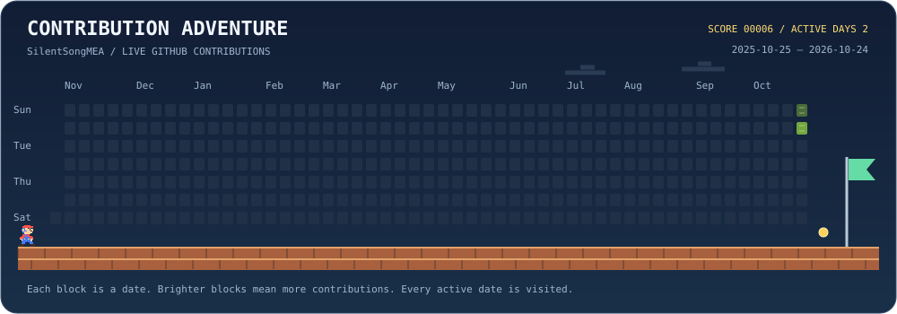

# Mohadeseh Asri

### Software Development · Python · AI & Automation

Building practical software, exploring local AI, and automating everyday workflows.

[GitHub](https://github.com/SilentSongMEA) · [Projects](https://github.com/SilentSongMEA?tab=repositories)

## About me

I work on internal business applications and enjoy turning everyday requirements into useful software.

- **Business software:** ASP.NET Core MVC, C#, JavaScript, and SQL Server.
- **Practical experience:** forms and validation, database queries, workflow features, API integration, debugging, and testing.
- **Python & data:** NumPy, Pandas, and image-processing notebooks.
- **Currently exploring:** local LLMs with Ollama, retrieval-augmented generation (RAG), and AI automation.

## Toolbox

**Application development:** C# · ASP.NET Core MVC · JavaScript · HTML · CSS · SQL Server · Entity Framework Core

**Python & AI:** Python · NumPy · Pandas · TensorFlow · Jupyter · Ollama

## Contribution adventure

Generated from my GitHub contribution calendar. Each block represents a date; brighter blocks indicate more contributions.

## Selected work

- [TeleBuch](https://github.com/SilentSongMEA/TeleBuch)
- [Image-processing notebooks](https://github.com/SilentSongMEA?tab=repositories)

Browse my pinned repositories below for selected projects, examples, and setup instructions.
